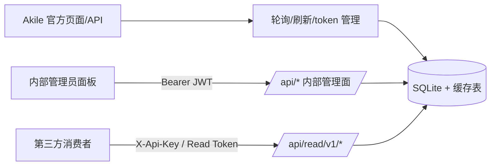

# Akile 第三方直读后端与更新计划

> **For Hermes:** Use subagent-driven-development skill to implement this plan task-by-task.

**Goal:** 让第三方系统可以通过一个只读、版本化、带鉴权的 API 直接读取 Akile Monitor 后端数据；同时把当前已经做好的评分、星级、价格推荐、token 状态、日志与机器快照整理成稳定的外部契约。

**更新准备分值：56.5/100**

**Architecture:** 现在的后端已经能采集并缓存机器快照，内部 admin API 也已经能读到机器、设置、日志、token 状态和账户缓存。下一步不是重写这些能力，而是把它们切成一个独立的“第三方只读面”，让外部消费方通过单独的 read-only 鉴权直接读取；内部 admin JWT 继续保留给运维/管理端使用。**延迟不做独立平均值采集，直接以官方网页显示值为准**；如果上游没有可用值，就保持空或不返回该字段，不额外探测。

---

## 1. 当前状态

### 已经有的能力

| 能力 | 状态 | 说明 |
|---|---:|---|
| 机器列表 API | 已有 | `GET /api/machines` 返回机器快照、评分、星级、价格推荐 |
| 刷新 API | 已有 | `POST /api/store/refresh` 手动触发刷新 |
| settings API | 已有 | `GET/POST /api/settings` |
| token 状态 / 刷新 | 已有 | `GET /api/token/status`、`POST /api/token/refresh` |
| 日志 API | 已有 | `GET /api/logs/app` |
| 账户缓存 | 已有 | `GET/POST /api/account` |
| 评分系统 | 已有 | `score` / `star_rating` / `price_recommendation` 已在后端计算 |
| 官方匹配 | 已有 | `official_match` 已经可以在二手机里返回 |

### 还没落实的部分

| 缺口 | 当前问题 | 为什么要补 |
|---|---|---|
| 第三方只读边界 | 现在所有能力混在内部 admin API 里 | 外部系统不应该复用管理员 JWT |
| 只读鉴权 | 还没有单独的 read-only token / key | 第三方需要稳定、可轮换的访问凭证 |
| 版本化契约 | 还没有独立的外部 API 版本 | 未来字段演进会很乱 |
| 脱敏与限流 | 没有专门的外部访问控制 | 需要防止误暴露 token / settings / logs |
| 外部筛选参数 | `min_score` 等阈值还没有正式外部契约 | 方便第三方直接筛选“可更新”的机器 |
| 文档与测试 | 没有外部 read API 的测试面 | 容易回归 |

---

## 2. 明确的非目标

这些内容这次**不做**：

- 不把管理员 JWT 直接给第三方使用
- 不把原始 token 暴露给第三方
- 不把日志默认开放给第三方
- 不做独立的延迟探测/平均延迟采集
- 不推测“优化线路”标签；只有上游明确给出时才返回
- 不增加写接口到第三方只读面

---

## 3. 目标架构



### 设计原则

1. **内部管理面与外部只读面分离**
   - 内部 API 继续使用现有 admin JWT
   - 外部 API 使用独立 read-only token / key

2. **字段分层**
   - 外部 API 只返回可消费的运行态数据
   - 不返回原始 token、密码、内部设置值、日志尾部内容

3. **评分在后端完成**
   - 第三方只读评分结果，不自己复算
   - 评分阈值用查询参数或设置项控制

4. **延迟只透传官方展示值**
   - 不引入平均值聚合
   - 不做独立 ping / RTT 探测

---

## 4. 建议的外部 API 契约

### 鉴权

- Header: `X-Api-Key: <READ_TOKEN>`
- Token 来源：`.env` / 环境变量
- 只读面与内部 admin JWT 完全分离

### 路由建议

| 路由 | 用途 |
|---|---|
| `GET /api/read/v1/meta` | 版本、构建信息、数据更新时间 |
| `GET /api/read/v1/machines` | 机器列表（支持筛选/排序） |
| `GET /api/read/v1/machines/{category}` | 按分类读取机器 |
| `GET /api/read/v1/health` | 只读健康状态（不含敏感配置） |

### 推荐查询参数

| 参数 | 作用 |
|---|---|
| `category` | `vps` / `ls` / `secondhand` |
| `available_only` | 只看在售数据 |
| `min_score` | 评分下限，第三方可直接拿来做筛选 |
| `min_star` | 星级下限 |
| `ip_status` | 二手机 IP 状态过滤：`normal` / `gfw` |
| `sort` | `score_desc` / `price_asc` / `star_desc` |

### 推荐返回字段

```json
{
  "version": "1",
  "updated_at": "2026-06-21T05:55:34+08:00",
  "items": [
    {
      "category": "vps",
      "plan_id": "xxx",
      "area": "JP",
      "node": "...",
      "name": "...",
      "stock": 12,
      "price_monthly": 9900,
      "price_yearly": 99000,
      "sale_price": null,
      "cpu": 4,
      "memory_mb": 8192,
      "disk_gb": 100,
      "bandwidth_mbps": 100,
      "traffic_gb": 2000,
      "ipv4": 1,
      "available": true,
      "ip_status": "",
      "score": 123.4,
      "star_rating": 5,
      "price_recommendation": {
        "recommend": "yearly",
        "reason": "...",
        "savings_pct": 18.5
      },
      "official_match": null,
      "updated_at": "2026-06-21T05:55:34+08:00"
    }
  ]
}
```

> 注意：这里不包含原始 token，也不把日志和内部 settings 全量给第三方。

---

## 5. 更新计划（按阶段）

### Phase 0：冻结外部契约

**目标：** 先把“第三方能读什么、不能读什么”定死，避免后面反复改。

**要确认的边界：**

- 允许：机器快照、评分、星级、价格推荐、官方匹配、更新时间、健康摘要
- 禁止：原始 token、密码、admin JWT、内部 settings 全量、日志全文
- 延迟：只透传官方展示值；没有就空，不新增平均值链路
- 优化线路：只有上游明确标记时才返回，不做推测

**文件：**
- `docs/plans/akile-third-party-read-api-update.md`
- `README.md`（后续补充对外说明）
- `CHANGELOG.md`（后续记录 API 变化）

**验收：**
- 任何实现都必须先对照这份边界文档，不允许先写接口再补约束

---

### Phase 1：新增只读鉴权

**目标：** 给第三方一个独立凭证，不再复用管理员 JWT。

**文件：**
- `backend/app/config.py`
- `backend/app/auth.py`
- `backend/.env.example`
- `backend/app/main.py`
- `backend/tests/test_read_api_auth.py`（新建）

**实现建议：**
- 新增 `PUBLIC_READ_TOKEN` 或同等命名的只读密钥
- 新增 `require_read_api_key()` 依赖
- 只读接口只接受 `X-Api-Key`
- 管理接口继续保留现有 Bearer JWT

**必须验证：**
- 只读接口拒绝空 key
- 只读接口拒绝管理员 JWT
- 管理接口拒绝只读 key
- 密钥不会出现在响应体或日志里

**验证命令：**
```bash
pytest backend/tests/test_read_api_auth.py -q
```

---

### Phase 2：抽出第三方只读路由

**目标：** 让第三方通过独立 namespace 读取机器与元数据。

**文件：**
- `backend/app/public_api.py`（新建）
- `backend/app/main.py`
- `backend/app/database.py`
- `backend/app/scoring.py`
- `backend/app/poller.py`

**建议路由：**
- `GET /api/read/v1/meta`
- `GET /api/read/v1/machines`
- `GET /api/read/v1/machines/{category}`
- `GET /api/read/v1/health`

**返回字段：**
- `score`
- `star_rating`
- `price_recommendation`
- `official_match`
- `updated_at`
- `available`
- `ip_status`

**注意：**
- 不返回原始 token
- 不返回 logs
- 不返回内部 settings 全量
- 不新增平均延迟探测

**验证命令：**
```bash
pytest backend/tests/test_public_api.py -q
```

---

### Phase 3：增加筛选与“分值准备更新”阈值

**目标：** 让第三方能按分值筛选“准备更新”的机器。

**文件：**
- `backend/app/public_api.py`
- `backend/app/config.py`
- `backend/tests/test_public_api_filters.py`（新建）

**建议参数：**
- `min_score`
- `min_star`
- `sort=score_desc`
- `available_only=1`

**建议行为：**
- 默认返回所有可读机器
- `min_score` 过滤在第三方读 API 内完成
- `score` 仍然由后端统一计算，第三方只消费结果

**验收：**
- `min_score=80` 只返回分数大于等于 80 的机器
- 星级过滤和评分过滤同时可用
- 无评分的数据不应该误判为高分

---

### Phase 4：补硬化与审计

**目标：** 外部读 API 上线前，把安全边界补齐。

**文件：**
- `backend/app/logging_setup.py`
- `backend/app/main.py`
- `backend/app/public_api.py`
- `backend/tests/test_public_api_security.py`（新建）

**建议项：**
- 记录只读 API 访问日志
- 加基础限流/频控
- 输出统一错误格式
- 敏感字段脱敏

**验收：**
- 访问日志可追踪谁在读
- key 错误时不会泄露内部信息
- 不会因为第三方访问而影响内部刷新链路

---

### Phase 5：文档与对外说明

**目标：** 让第三方知道怎么接，不用再问一轮。

**文件：**
- `README.md`
- `CHANGELOG.md`
- `docs/plans/akile-third-party-read-api-update.md`

**要写清楚：**
- 只读 API 的 base path
- 请求头 `X-Api-Key`
- 可读字段清单
- 禁止字段清单
- `min_score` / `min_star` 的用法
- 延迟不做平均值，不做独立探测

---

## 6. 推荐的优先级

| 优先级 | 项目 | 理由 |
|---|---|---|
| P0 | 只读鉴权 | 没有这个就不能安全给第三方用 |
| P0 | 只读路由 namespace | 先把入口和内部接口隔开 |
| P0 | 字段白名单 | 防止 token / settings 外泄 |
| P1 | `min_score` / `min_star` | 直接满足“分值准备更新”的筛选需求 |
| P1 | 审计与限流 | 外部读面必须可控 |
| P2 | 文档与示例 | 方便第三方接入 |

---

## 7. 这次计划里的关键约束

1. **第三方读 API 只读，不写**
2. **管理员 JWT 不外放**
3. **原始 token 不下发**
4. **延迟只用官方网页显示值，不做平均值采集**
5. **评分继续由后端统一计算，第三方只消费结果**
6. **如果上游没有明确“优化线路”标记，就不要猜**

---

## 8. 下一步建议

如果这份计划你点头，下一步就按这个顺序做：

1. 先落只读鉴权
2. 再挂 `/api/read/v1/*`
3. 再补 `min_score` / `min_star`
4. 最后补测试和文档

这样第三方就能直接读咱们后端，而且不会把内部管理面一起暴露出去。
